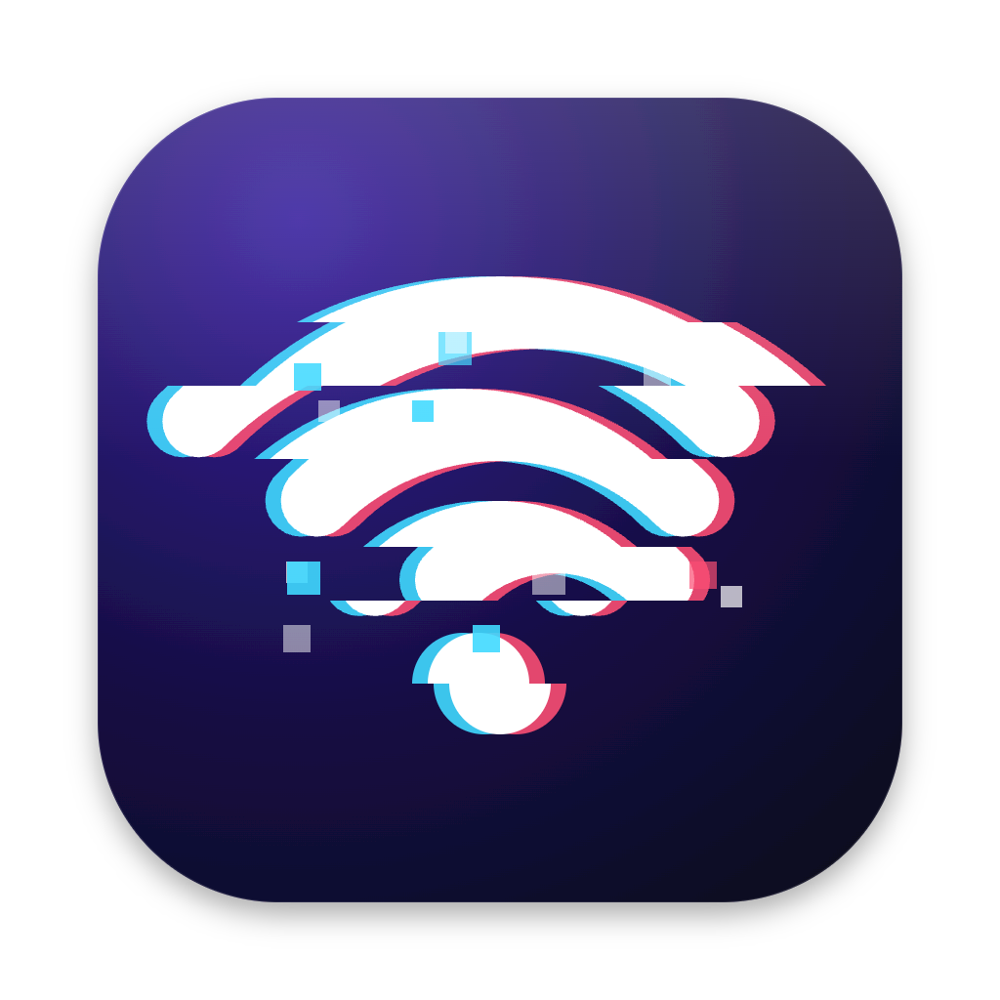
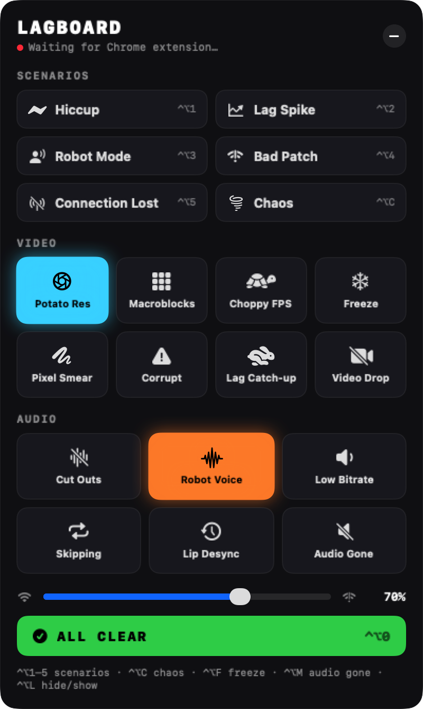
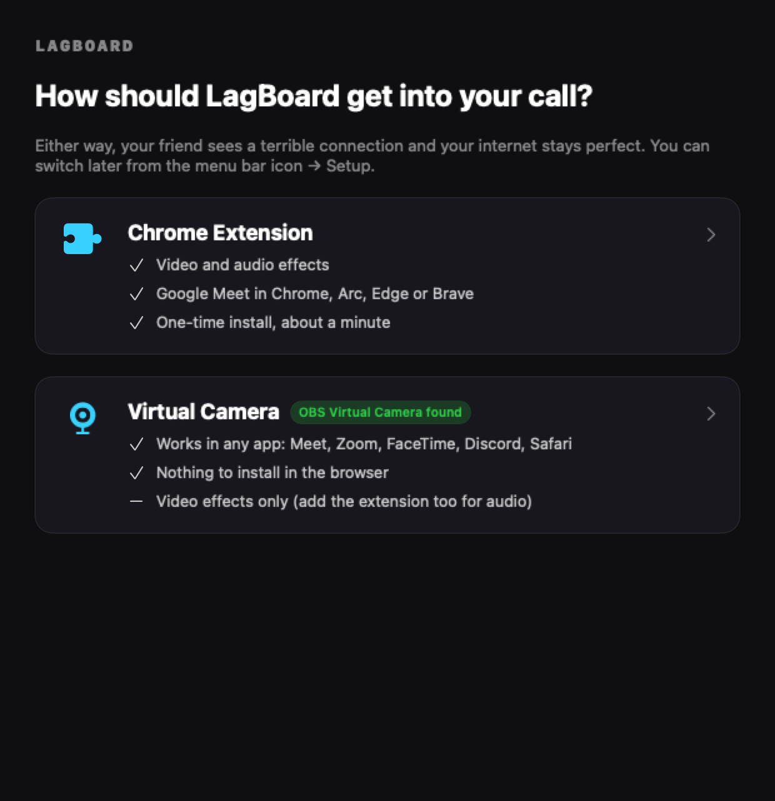
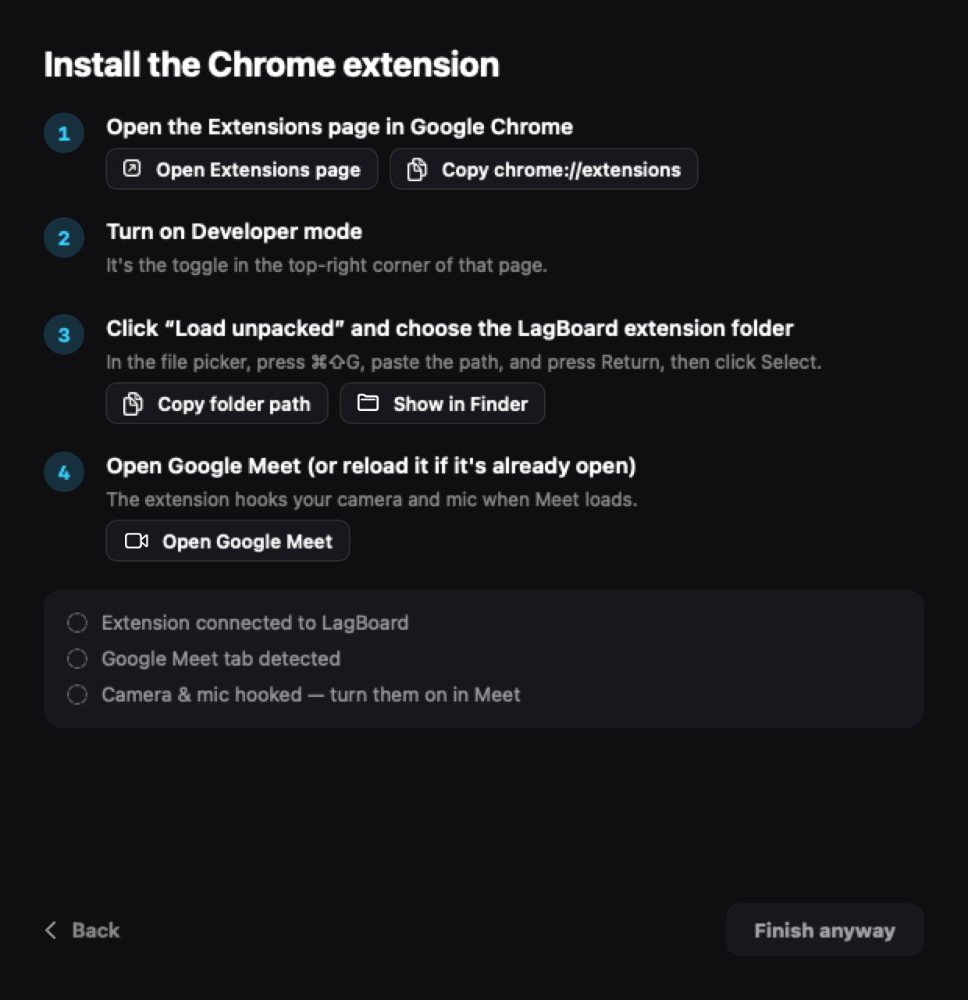

<p align="center"></p>

# LagBoard

**A soundboard for fake bad-connection effects on video calls.** Tap a pad and your
friend sees your video freeze, smear and break into compression blocks, and hears your
voice turn robotic and cut out. Your internet is fine.

<p align="center">
  
</p>

- **Floating control panel.** It stays above every window (full-screen calls included),
  is excluded from screen capture, never takes focus from your call, and has global hotkeys.
- **Realistic artifacts.** Effects copy what real network trouble looks like on
  WebRTC calls: low-bitrate compression, packet-loss smearing, half-decoded frames,
  Opus packet-loss-concealment "robot voice", jitter-buffer dropouts and more.
- **Two ways in.** A Chrome extension for Google Meet (video + audio), or a virtual
  camera that works in any app (video).

> Requires an Apple Silicon Mac running macOS 14 or later.

## Install

### Download

1. Grab `LagBoard-<version>-macOS-arm64.zip` from the [latest release](../../releases/latest) and unzip it.
2. Move `LagBoard.app` to Applications.
3. The app is ad-hoc signed, not notarized, so macOS blocks it the first time. Either:
   - open it, then go to **System Settings → Privacy & Security** and click **Open Anyway**, or
   - run `xattr -dr com.apple.quarantine /Applications/LagBoard.app` in Terminal.

### Build from source

```sh
git clone https://github.com/Phennova/lagboard.git
cd lagboard
./app/build.sh            # → app/LagBoard.app
./app/release.sh 1.0.1    # optional: → dist/LagBoard-1.0.1-macOS-arm64.zip
```

Needs Xcode or the Command Line Tools (Swift 5.9+). No other dependencies.

## Setup

On first launch, LagBoard asks how it should get into your call. You can change this
later from the menu bar icon (⚠︎ Wi-Fi) → **Setup…**.

<p align="center">
  
  
</p>

| | Chrome Extension | Virtual Camera |
|---|---|---|
| **Works in** | Google Meet in Chrome, Arc, Edge or Brave | Any app: Meet, Zoom, FaceTime, Discord, Safari… |
| **Effects** | Video + audio | Video (add the extension too for audio) |
| **Needs** | Loading an unpacked extension (setup walks you through it) | OBS Studio's free virtual camera driver |

**Chrome Extension.** Setup has buttons that open `chrome://extensions`, copy the
extension folder path, and open Meet. A live checklist turns green as the extension
connects and hooks your camera and mic. Load or reload Meet *after* installing it.

**Virtual Camera.** Allow camera access and pick which real camera to use. A live
preview lets you try effects. Then choose **OBS Virtual Camera** as the camera in your
call. LagBoard turns your real camera on automatically when the call starts using the
virtual camera. Turn it off with the 🎥 button on the panel or from the menu bar.

> **Why OBS?** macOS only loads camera drivers signed with a paid Apple Developer
> certificate. OBS Studio's driver is free and already certified, and it accepts frames
> from other apps, so LagBoard renders the effects itself and feeds them in. OBS doesn't
> need to be running. If it isn't installed, setup links to the download. Open OBS once
> and click *Start Virtual Camera* to install the driver.

## Controls

**Scenarios** are scripted sequences that play out on their own:

| Key | Scenario | What happens |
|---|---|---|
| ⌃⌥1 | Hiccup | 1 s freeze + audio gap, then a smeary recovery |
| ⌃⌥2 | Lag Spike | Video freezes with audio cut, then fast-forwards at 3× to catch up |
| ⌃⌥3 | Robot Mode | Robotic voice, choppy low-res video, a corrupted-frame burst |
| ⌃⌥4 | Bad Patch | 10 s of mixed trouble |
| ⌃⌥5 | Connection Lost | Freeze → robot voice → 6 s of silence → corrupted, blocky, smeared reconnect → slow recovery |
| ⌃⌥C | Chaos | Random realistic events until you turn it off. The slider sets how bad and how often. |

**Pads** toggle a single effect on or off. A solid pad is on. An outlined pad is being
driven by a scenario or Chaos.

| Video | | Audio | |
|---|---|---|---|
| Potato Res | Real low-bitrate compression: smudged detail, block edges, color bleed, lower fps | Cut Outs | Audio drops mid-sentence |
| Macroblocks | Bitrate-starved compression blocks | Robot Voice | Opus packet-loss concealment buzz |
| Choppy FPS | 2–10 fps with random hitches | Low Bitrate | Crunchy, muffled, underwater |
| Freeze (⌃⌥F) | Stuck frame | Skipping | 60 ms chunks repeat |
| Pixel Smear | Lost reference frame: moving parts "melt" and drag | Lip Desync | Audio falls 0.3–0.85 s behind video |
| Corrupt | Grey/green half-frames, stretched last row, torn bands | Audio Gone (⌃⌥M) | Silence |
| Lag Catch-up | Freezes while recording, plays the backlog at 3× when released | | |
| Video Drop | Black feed | | |

- **Intensity slider:** scales every effect and the Chaos rate.
- **ALL CLEAR (⌃⌥0):** instantly back to a perfect connection.
- **⌃⌥L:** hide or show the panel.

Quitting LagBoard clears every effect. Your self-view shows the effects too, so you
see what the other side sees.

## How it works

```
                     ┌─────────────── Chrome Extension mode ───────────────┐
 LagBoard panel ──ws://127.0.0.1:47823──▶ extension ──▶ Meet's getUserMedia
   (Swift)                               (MediaStreamTrackProcessor → effects
     │                                    → MediaStreamTrackGenerator)
     │
     └──── Virtual Camera mode ───▶ camera → native effects → OBS Virtual Camera sink
                                    (AVFoundation, CoreGraphics, VideoToolbox, CoreMediaIO)
```

- **Extension** (`extension/`): a MAIN-world content script wraps `getUserMedia` on
  meet.google.com and runs camera and mic frames through insertable streams. Audio is
  processed in 20 ms "packets", like Opus, so losses and concealment happen at
  realistic granularity. With nothing active, frames pass through untouched.
- **Native engine** (`app/Sources/NativeFX.swift`): a port of the video effects for
  Virtual Camera mode. It pushes frames into OBS's CMIO sink stream, the same mechanism OBS uses.
- **Potato Res** runs frames through a real encoder at a starvation bitrate (VP8 via
  WebCodecs in the extension, H.264 via VideoToolbox natively), so the artifacts are genuine.
- **Local only.** The WebSocket server binds to 127.0.0.1 and only sends effect state.
  Nothing leaves your machine.

## Screen sharing

The panel uses `NSWindow.sharingType = .none`, so it doesn't appear in screenshots.
Since macOS 15, though, some apps capturing the *entire screen* through ScreenCaptureKit
may still see it. To be safe, share **a tab** or **a single window** instead.

## Project layout

```
app/
  Sources/     Swift app: panel UI, setup flow, WebSocket server, native effects, virtual camera
  Resources/   AppIcon.icns
  build.sh     builds app/LagBoard.app (arm64)
  release.sh   builds + zips a release into dist/
extension/     Chrome extension (Manifest V3)
design/        app icon concepts + generator (make_icons.py); the app uses b-glitched-wifi
docs/          screenshots
```

To use the extension on other sites (e.g. Discord web), add them to both `matches`
lists in `extension/manifest.json`.

---

Made for harmless pranks on friends.
